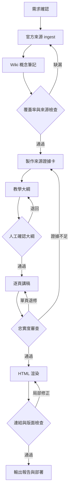

# Graph／Loop 設計 v1.0

## 節點／輸入／輸出／失敗分支
| 節點 | 輸入 | 輸出 | 檢查 | 退回 |
|---|---|---|---|---|
| Ingest | 官方文件、`raw/source_cards.json` | `wiki/sources/`, `wiki/log.md` | 來源 ID、URL、文章數至少 5 | 補來源 |
| Wiki | 已 ingest 來源卡 | `wiki/concepts/` | 每條重要結論有來源 ID | 來源或概念頁 |
| Evidence | Wiki 頁 | `slides/cards/` | 重點及來源對應 | Wiki |
| Outline | 教學目標與證據卡 | `slides/outline.md` | 概念順序、沒有內容缺口；人工審核 | Outline 或 Evidence |
| Draft | 核准大綱和 Evidence | `slides/drafts/` | 專業術語、事實忠實度 | 該頁 Draft |
| Render | 通過審查的文字 | `slides/deck.html` | HTML 結構、連結、排版 | 只修 HTML/CSS |
| Report | 所有檢查輸出 | `slides/report.md` | 真實 PASS/FAIL、重測、反思 | 相應節點 |

## 停止條件
每個局部 Loop 最多 3 輪；失敗時保留錯誤報告並停止；不可無限制重新生成，也不可把未做的檢查寫為 PASS。

## 第二階段實際採用的關卡

圖中的人工關卡已於 2026-11-21 由使用者核准。接續時先登錄此決定，再執行 Evidence。Coverage 先驗 Wiki 來源、概念、事實編號與頁碼；Faithfulness 再由未寫稿的審查者判讀「該條摘錄能否支持這句話」。若句子本身正確而指向的摘錄太籠統，只退回該頁 Evidence。Render 讀取通過審查的資料指紋；若前置資料有變動，須重新審查。Report 先輸出離線驗收版；Publish 等待使用者驗收。
